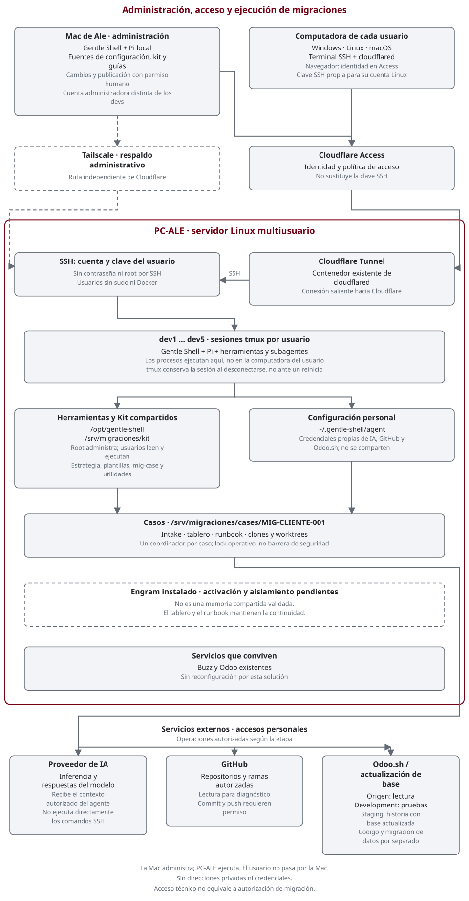

# Arquitectura de la solución

**PC-ALE ejecuta las migraciones; la Mac de Ale administra la plataforma;
cada usuario trabaja desde su propia computadora.** Gentle Shell utiliza Pi como
runtime del agente en ambos equipos. Las conexiones de los usuarios van al servidor:
el trabajo remoto **no pasa por la Mac**.

## Diagrama de arquitectura

<figure class="process-diagram" tabindex="0" aria-label="Arquitectura de la solución; gráfico adaptable al ancho disponible">
  
  <figcaption>Líneas continuas: acceso y trabajo. Líneas discontinuas: administración de respaldo o componentes pendientes. Abra el gráfico completo para ampliarlo.</figcaption>
</figure>

[Abrir el gráfico completo](assets/solution-architecture.svg).
Los bloques y recorridos se describen a continuación.

## 1. Mac de Ale — Administración

Es el puesto desde el que se instala, configura y mantiene la solución:

- Ejecuta su propia instancia de **Gentle Shell + Pi**, independiente de la del servidor.
- Mantiene las fuentes de configuración, el kit y la documentación; prepara cambios
  y comprobaciones antes de enviarlos al servidor.
- Accede por SSH con la cuenta administradora para instalar herramientas compartidas,
  gestionar usuarios y revisar permisos. Los cambios privilegiados requieren autorización y sudo.
- Conserva un acceso administrativo de respaldo por **Tailscale**, independiente del
  acceso habitual del equipo mediante Cloudflare.
- Publica la documentación aprobada en GitHub Pages; el sitio explica el uso, no controla el servidor.

«Gobernar» significa administrar y coordinar cambios, no compartir una sesión ni una cuenta.
No se ha implementado un servicio de control automático que replique todo lo que cambia en la Mac.
Apagarla no es, por diseño, una orden de detener las sesiones de PC-ALE;
la continuidad sigue dependiendo del servidor, la red y los servicios externos.

## 2. Computadora del usuario — Acceso

Puede usar **Windows, Linux o macOS**. Necesita un cliente SSH, `cloudflared`,
una clave personal y su identidad autorizada en Cloudflare Access.

1. El navegador completa la autenticación de Cloudflare.
2. `cloudflared access ssh` transporta la conexión hacia el túnel existente.
3. SSH comprueba la clave pública para su cuenta Linux, por ejemplo `dev1`.
4. El usuario abre o recupera su sesión de tmux y ejecuta Gentle Shell en el caso autorizado.

La interfaz de terminal se ve en la computadora del usuario, pero **los procesos, comandos
y archivos del trabajo remoto están en PC-ALE**. No hace falta instalar Gentle Shell ni
un runtime Odoo en la computadora del usuario para este recorrido.

Siga los comandos del [manual de uso](gentle-shell.md).

## 3. PC-ALE — Ejecución

Servidor Linux multiusuario que concentra herramientas y espacios de trabajo.
La instalación base y el kit están preparados para iniciar casos; eso no reemplaza
los accesos, permisos y verificaciones específicos de cada migración.

| Componente | Función y ubicación |
| --- | --- |
| SSH | Admite claves y cuentas del grupo autorizado; no contraseñas ni acceso root por SSH |
| Cloudflare Tunnel | Conserva el contenedor del túnel existente; conecta el servidor con Cloudflare |
| Usuarios Linux | `dev1` a `dev5`, cada uno con home y configuración personal, sin sudo ni Docker |
| tmux | Conserva la terminal y sus procesos cuando el usuario se desconecta; no sobrevive por sí solo a un reinicio del servidor |
| Gentle Shell + Pi | Ejecuta el agente, sus herramientas y los subagentes en la sesión del usuario |
| Instalación compartida | Herramientas bajo `/opt/gentle-shell`, administradas por root y no modificables por los usuarios del equipo |
| Configuración personal | `~/.gentle-shell/agent` en cada cuenta; autenticación y estado propios |
| Kit de migración | `/srv/migraciones/kit`, compartido en modo lectura: estrategia, plantillas y utilidades |
| Casos | `/srv/migraciones/cases/MIG-CLIENTE-001`, compartidos según los permisos del grupo |

Cada caso contiene intake, tablero, runbook y preferencias del modelo.
Los clones y worktrees autorizados se mantienen dentro del espacio del caso.
La adaptación de código se realiza allí; las pruebas del runtime Odoo se realizan en
los entornos Odoo.sh autorizados, no en un contenedor Odoo nuevo de esta solución.

### Coordinación dentro del servidor

Debe haber **un coordinador por caso**, incluso cuando intervengan otros sistemas de agentes.
`mig-case claim` registra quién coordina y `mig-case release` entrega esa coordinación.
El lock es un acuerdo operativo, no impide por sí solo que otro integrante edite archivos.

El coordinador mantiene el tablero y asigna trabajos acotados. Los subagentes trabajan
sobre superficies disjuntas o worktrees aislados; los verificadores revisan evidencias.
No se deben iniciar dos coordinadores sobre el mismo caso para «trabajar más rápido».

## 4. Servicios externos

| Servicio | Relación con PC-ALE |
| --- | --- |
| Proveedor de IA | Recibe las solicitudes del agente con las credenciales del usuario; las herramientas ejecutan en el servidor bajo sus permisos |
| GitHub | Proporciona repositorios y recibe cambios solo con permiso explícito de commit/push; no se copian cuentas entre usuarios |
| Odoo.sh origen | Se consulta en modo lectura para inventario y diagnóstico dentro del alcance autorizado |
| Odoo.sh Development | Recibe código y pruebas de funcionamiento cuando esa etapa está autorizada |
| Odoo.sh Staging | Se usa para validar la base actualizada y la historia con restauración y aislamiento autorizados |
| Proveedor de actualización | Entrega la base actualizada según cobertura acordada; portar módulos no migra por sí solo los datos |

Tener acceso a un servicio no autoriza todas sus operaciones. Las decisiones por etapa
se mantienen junto a las instrucciones del [Procedimiento](procedure.md#7-seguir-al-agente-y-el-plan-en-espiral).

## 5. Credenciales y separación de responsabilidades

- Cada usuario configura sus propios accesos al modelo, GitHub y Odoo.sh en su cuenta Linux.
  El login de Cloudflare, la clave SSH y el login del modelo son controles distintos.
- Las claves privadas no se distribuyen desde la Mac ni se guardan en el kit o los casos.
- Los archivos compartidos de un caso son visibles para las personas autorizadas a ese espacio;
  no se deben usar para guardar secretos personales.
- La cuenta administradora mantiene la plataforma. Las cuentas del equipo ejecutan únicamente
  lo autorizado para la migración. Ningún agente reemplaza la aprobación humana.
- El contenido enviado al proveedor de IA debe pertenecer al alcance y tratamiento de datos
  autorizados; usar SSH no evita que el agente envíe contexto al modelo.

## 6. Límites y pendientes

La arquitectura distingue lo instalado de lo validado:

- Se comprobaron acceso SSH externo, arranque de Gentle Shell, utilidades del kit y permisos básicos.
- **Engram está instalado, pero su activación y aislamiento multiusuario siguen pendientes.**
  No se representa como una memoria compartida operativa. El runbook y el tablero son el registro explícito.
- La compatibilidad del editor instalado y la prueba de relevo real entre usuarios siguen pendientes.
- No se documenta aquí una recuperación ensayada de todo el servidor ni una auditoría completa de seguridad.
- Los agentes Buzz, los servicios Odoo existentes y el túnel conviven con la solución;
  este trabajo no los reconfigura ni habilita coordinación simultánea del mismo caso.
- No se muestran hostnames, IPs, emails, claves ni datos de clientes. Los rótulos «PC-ALE»
  y «Mac de Ale» son los nombres solicitados para explicar los roles de los equipos.

**Para operar:** abra [Gentle Shell](gentle-shell.md). **Para planificar una migración:**
complete el [mensaje inicial del Procedimiento](procedure.md#5-si-inicia-informar-repositorio-y-accesos).
