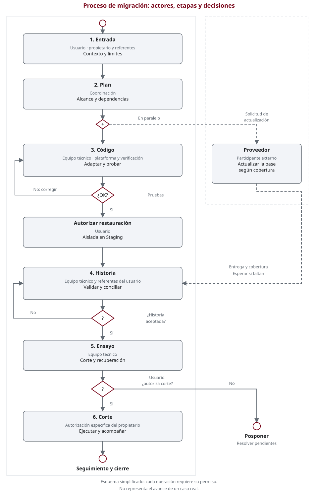

# Procedimiento

El recorrido tiene seis etapas. Se trabaja en ciclos pequeños: si una prueba falla,
se corrige y se repite; si falta una decisión, se pausa la tarea afectada.
**El corte se planifica desde el inicio, pero se autoriza al final.**

## El proceso de un vistazo

Diagrama **tipo BPMN simplificado**: los carriles indican actores, los rectángulos
tareas, los rombos decisiones y los círculos inicio o fin. Las líneas discontinuas
representan intercambios con el proveedor. Es una ayuda de lectura; **no es un modelo ejecutable**
ni una especificación BPMN completa.

<figure class="process-diagram" tabindex="0" aria-label="Diagrama del procedimiento; desplazamiento horizontal disponible">
  
  <figcaption>Lea de arriba hacia abajo. En pantallas pequeñas, desplace el diagrama o abra la imagen.</figcaption>
</figure>

[Abrir el diagrama completo](assets/migration-process.svg).
Las etapas siguientes son su equivalente en texto.

## 1. Entrada: acordar qué se va a migrar

**Usuario y coordinación.** El usuario entrega versiones, edición, procesos críticos,
fuentes permitidas y límites. Coordinación revisa la información y devuelve preguntas,
responsables y una propuesta de alcance.

**Se avanza con:** entrada revisada y permisos explícitos. Sin una respuesta necesaria,
la tarea queda pendiente; tener acceso no autoriza modificar el sistema.

## 2. Plan: inventariar y decidir

**Coordinación y equipo técnico, con el proveedor.** Se contrasta lo instalado con
el código disponible, incluyendo Studio, módulos de terceros y dependencias auto-instalables.
Se decide por módulo: adaptar, usar una versión existente, reemplazar, retirar o investigar.
El dueño funcional acepta el impacto de reemplazos o retiradas.

En paralelo, el proveedor confirma la ruta de actualización de la base, su cobertura
y exclusiones. Un nombre de módulo similar no demuestra equivalencia ni conversión de datos.

**Se avanza con:** inventario, decisiones, orden de trabajo y pruebas esperadas.
Las incógnitas tienen pregunta, rol decisor y condición de desbloqueo.

## 3. Código: adaptar y probar por grupos

**Equipo técnico; coordinación organiza las entregas.** Primero se adaptan las dependencias
compartidas y después los módulos que las utilizan. Se revisan API, vistas, permisos y pruebas.
Cada grupo se prueba en **Development aislado y autorizado**, sin efectos en correo,
bancos, servicios fiscales ni otras integraciones.

**Se avanza con:** resultados de instalación, permisos y escenarios acordados.
Un fallo vuelve al ciclo de adaptación; una dependencia fuera del alcance vuelve a decisión.
Con varios desarrolladores o agentes, se usan archivos exclusivos y espacios de trabajo aislados.

## 4. Historia: validar la copia migrada

**Equipo técnico y responsables funcionales/contables; el proveedor aporta la entrega.**
Se necesita la base actualizada y autorización específica para restaurarla de forma aislada
en **Staging**. Antes de probar se acuerdan valores esperados y tolerancias.

Se contrastan saldos, pagos, impuestos, stock, documentos, numeraciones y permisos según
el alcance. Los referentes explican y aceptan las diferencias; una base nueva no sustituye esta prueba.

**Se avanza con:** conciliaciones registradas y aceptación humana. Sin base, permiso o
criterios, esta etapa espera; no se presume su resultado a partir de las pruebas de código.

## 5. Ensayo: comprobar corte y recuperación

**Equipo técnico, plataforma y usuario.** Se ensayan, bajo autorización, la ventana,
el congelamiento de escrituras, las verificaciones y la recuperación. Se consideran
las escrituras posteriores y los efectos externos, no solo los archivos.

**Se avanza con:** tiempos y límites observados, recuperación comprobada, responsables
y plan de seguimiento. Un ensayo fallido se corrige antes de proponer producción.

## 6. Corte: decidir, ejecutar y acompañar

**El propietario decide; el equipo autorizado ejecuta.** Se presentan las evidencias,
fallos, comprobaciones omitidas y riesgos residuales. La aprobación funcional o contable
no reemplaza la autorización específica de corte. Si no se autoriza, se pospone.

**Cierre:** verificaciones posteriores, seguimiento de incidencias y aceptación registrada.
Ante pérdida de aprobación o un fallo crítico, se detiene y se consulta el plan aprobado,
sin improvisar reparaciones ni reversión.

## Qué recibe el usuario en cada entrega

Un resumen breve: **qué se hizo, qué se comprobó, qué falta y qué decisión se necesita**.
Los resultados se marcan como aprobados, fallidos o no comprobados, con su contexto.
No se confunde avance de código con datos aceptados ni con producción autorizada.

**Siguiente paso:** complete las [Instrucciones del usuario](user-instructions.md).
Para profundizar, se conservan las [plantillas](migration-templates.md) y la
[lista de validación](validation.md) como referencias fuera del menú principal.
